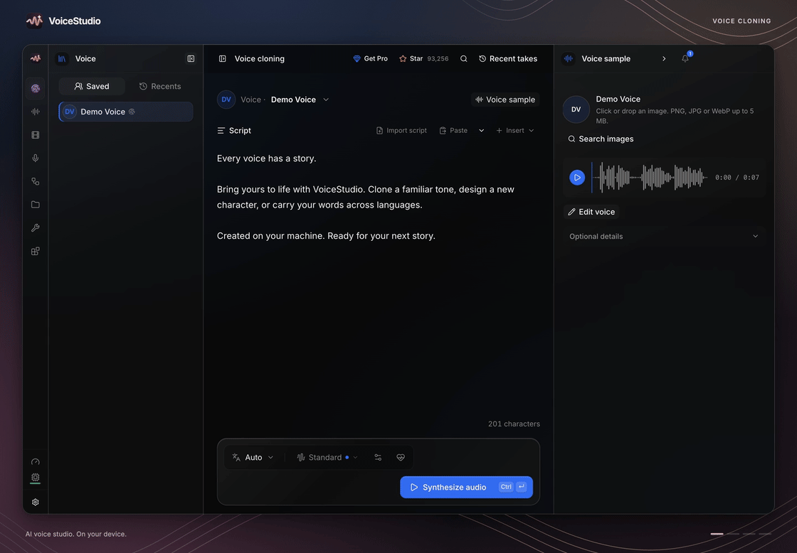

<div align="center">
  
  <h1>VoiceStudio</h1>
  <p><a href="https://trendshift.io/repositories/28176?utm_source=repository-badge&amp;utm_medium=badge&amp;utm_campaign=badge-repository-28176" target="_blank" rel="noopener noreferrer"></a></p>
  <p><strong>支持 646 种语言的开源声音克隆、声音设计、视频配音、听写、转录与有声书制作工具。</strong></p>
  <p>
    <a href="https://voicestudio.sh/?utm_source=github&utm_medium=readme&utm_campaign=project">网站</a> ·
    <a href="https://github.com/debpalash/VoiceStudio/releases/latest">下载</a> ·
    <a href="#开始使用">开始使用</a> ·
    <a href="#文档">文档</a> ·
    <a href="https://discord.gg/bzQavDfVV9">Discord</a> ·
    <a href="../../README.md">English</a> ·
    <a href="README_JA.md">日本語</a> ·
    <a href="README_KO.md">한국어</a> ·
    <a href="README_RU.md">Русский</a>
  </p>
  <p>
    <a href="https://github.com/debpalash/VoiceStudio/actions/workflows/ci.yml"></a>
    <a href="https://github.com/debpalash/VoiceStudio/releases/latest"></a>
    <a href="../../LICENSE"></a>
    <a href="https://supermetry.com"></a>
  </p>
  <p>
    <sub>战略赞助商</sub><br />
    <a href="https://supermetry.com/?utm_source=voicestudio&utm_medium=sponsor&utm_campaign=strategic-sponsor&utm_content=readme-logo"><picture><source media="(prefers-color-scheme: dark)" srcset="../../docs/sponsors/supermetry-dark.svg" /></picture></a>
  </p>
</div>



## 你的声音，你的工作方式

| 塑造声音 | 完成作品 | 接入工具 |
| :--- | :--- | :--- |
| 克隆声音或设计专属声音 | 用精准对时的语音为视频配音 | 面向智能体的本地 API 与 MCP |
| 使用悬浮窗口听写 | 制作故事、有声书与批量任务 | 可复用配方与监视文件夹 |

可以从默认的 **VoiceStudio**（由 k2-fsa/OmniVoice 驱动）开始，也可以选择其他引擎。参见[功能与引擎目录](../../docs/feature-catalog.md)。

本地工作流在你的设备上运行。远程服务均为可选项；使用分析数据前会征求同意。

<details>
<summary><strong>浏览各个工作区</strong> · 克隆、配音、设计与模型</summary>

<table>
  <tr>
    <td></td>
    <td></td>
  </tr>
  <tr><td align="center">声音克隆</td><td align="center">视频配音</td></tr>
  <tr>
    <td></td>
    <td></td>
  </tr>
  <tr><td align="center">声音设计</td><td align="center">本地模型</td></tr>
</table>


</details>

在 Windows 和 Linux 上，从源码构建的 OmniVoice GGUF 可选择使用 Vulkan；构建要求、CPU 回退与设备覆盖设置请查阅[原生引擎指南](../../docs/engines/omnivoice-gguf.md#optional-vulkan-acceleration)。

## 开始使用

### 一条命令安装（macOS / Linux）

```sh
# 安装目前发布的 Electron 应用
curl -fsSL https://voicestudio.sh/install | sh

# 安装某个发行版本，请把 X.Y.Z 改成所需版本号
curl -fsSL https://voicestudio.sh/install | sh -s -- --version X.Y.Z

# 从 main 分支构建并安装桌面端
curl -fsSL https://voicestudio.sh/install | sh -s -- --main

# 移除程序，但不删除个人数据
curl -fsSL https://voicestudio.sh/install | sh -s -- --uninstall
```

Windows 用户请在 PowerShell 中运行 `irm https://voicestudio.sh/install.ps1 | iex`。

若 `voicestudio.sh/install` 无法访问或返回 404，可直接从仓库运行同一脚本，也可克隆仓库后运行 `scripts/install.sh`：

```bash
curl -fsSL https://raw.githubusercontent.com/debpalash/VoiceStudio/main/scripts/install.sh | sh
```

下载发行版需要 curl 和 SHA-256 工具。`--main` 还需要 Git、Node.js 22+、Bun、Rust/Cargo 以及对应平台的构建工具；详见[安装脚本说明](../../docs/install/script.md)。安装程序会保留设置、项目和模型。旧版本必须包含 Electron 软件包；程序不会回退到已归档的 Tauri 构建。

也可以从 [Releases](https://github.com/debpalash/VoiceStudio/releases/latest) 下载（macOS `.dmg`、Windows `.exe`、Linux `.AppImage` 或 `.deb`、Android `.apk`、iPhone `.ipa`；Linux 也可运行 `sudo snap install voicestudio`），并按照系统指南操作：

**[macOS](../../docs/install/macos.md) · [Windows](../../docs/install/windows.md) · [Linux](../../docs/install/linux.md) · [Docker](../../docs/install/docker.md) · [Android 与 iPhone](../../docs/mobile.md#install)**

| 硬件 | 支持情况 |
|---|---|
| NVIDIA GPU（Windows / Linux） | CUDA 加速 |
| AMD Radeon / 支持的 Ryzen AI（Windows） | 默认使用 CPU；可根据 AMD 的 Windows 11 硬件列表[选择安装 Windows ROCm](../../docs/install/windows-rocm.md)。 |
| Apple Silicon（M1–M5） | Metal（MPS）加速 |
| AMD GPU | 原生 CosyVoice GGUF 可选择使用 Vulkan（[设置指南](../../docs/engines/cosyvoice-gguf.md)） |
| 无独立 GPU | 可完整使用 CPU，速度较慢；小型 CPU 版 PyTorch 约需 5 GB 空间 |
| Windows on ARM | **实验性支持**：原生 ARM64 应用，x64 Python 后端在模拟层中运行，仅 CPU |
| Intel Mac | 仅应用界面可用；请连接远程后端（[原因](../../docs/install/macos.md)） |
| Android 手机（Android 10+） | **预览版**：模型在手机上运行，下载后可离线使用（[安装](../../docs/mobile.md#install)） |
| iPhone 与 iPad（iOS 17+） | **预览版**：模型在设备上运行；使用 Apple ID 侧载 IPA（[安装](../../docs/mobile.md#install)） |

打开**声音克隆**，选择声音或添加清晰的参考录音，输入文本并生成。出现提示时安装所需模型。各引擎对硬件的要求不同，参见[性能说明](../../docs/performance.md)。

### 通过提示词安装

将下面内容粘贴到编码智能体（Claude Code、Codex、Cursor 等）中：

```text
Install the VoiceStudio Electron app on this device and verify it works, following
https://github.com/debpalash/VoiceStudio/blob/main/docs/install/agent.md
```

[智能体安装指南](../../docs/install/agent.md)介绍硬件检测、复用已有数据、下载模型前询问用户以及测试生成。支持技能的智能体也可以运行 `npx skills add debpalash/VoiceStudio`。

<details>
<summary><strong>从源码运行 Electron 预览版</strong></summary>

```bash
git clone https://github.com/debpalash/VoiceStudio.git
cd VoiceStudio
bun install
bun run setup:api  # prepare Python dependencies before starting Electron
bun run dev
```

前置要求和后端配置请参见 [Electron 设置](../../electron/README.md)。运行 `bun run smoke-test` 可构建并启动隔离的打包应用；添加 `-- --install` 可检查联网安装。

</details>

> **Electron 是唯一的桌面应用和 Web UI。** 0.5.3 是最后一个 Tauri 版本。现有 Tauri 用户必须[单独安装 Electron](../../docs/electron-migration.md)。已退役的 Tauri 外壳和旧 UI 入口均已移除。

## 文档

| 需求 | 从这里开始 |
|---|---|
| 安装帮助 | [故障排查](../../docs/install/troubleshooting.md) · [模型下载](../../docs/downloading-models.md) |
| 模型与音质 | [引擎指南](../../docs/engines/README.md) · [whisper.cpp ASR](../../docs/engines/whisper-cpp.md) · [性能基准](../../docs/benchmarks.md) |
| 集成 | [本地 API](../../docs/speech-platform.md) · [MCP](../../docs/mcp.md) · [示例](../../examples/README.md) |
| 手机应用（预览版，可离线运行） | [iOS 与 Android](../../docs/mobile.md) |
| 开发 | [参与贡献](../../.github/CONTRIBUTING.md)（首次 PR 请阅读 [CLA 签署说明](../../.github/CONTRIBUTING.md#contribution-licensing)）· [Electron](../../electron/README.md) · [更新日志](../../CHANGELOG.md) |

智能体技能：`npx skills add debpalash/VoiceStudio`——音频工作流选择 **voicestudio**，仓库维护选择 **voicestudio-maintainer**。

## 团队

### 核心团队

<table>
<tr>
<td align="center" width="200"><a href="https://github.com/debpalash"></a><br><b>Palash Debnath</b><br><sub>创始人与核心团队</sub><br><sub><a href="https://palash.dev">palash.dev</a> · <a href="https://github.com/debpalash">GitHub</a> · <a href="https://x.com/idebpalash">X</a></sub></td>
<td align="center" width="200"><a href="https://github.com/velixio"></a><br><b>Shimul Debnath</b><br><sub>核心团队</sub><br><sub><a href="https://shimul.me">shimul.me</a> · <a href="https://github.com/velixio">GitHub</a> · <a href="https://x.com/shimuldn">X</a></sub></td>
</tr>
</table>

### 贡献者

<a href="https://github.com/kevin9327"></a> <a href="https://github.com/jaketame"></a> <a href="https://github.com/psiberfunk"></a> <a href="https://github.com/rudycelekli"></a> <a href="https://github.com/paoloantinori"></a> <a href="https://github.com/Chang-Jin-Lee"></a> <a href="https://github.com/swadhinbiswas"></a> <a href="https://github.com/BichengWang"></a> <a href="https://github.com/nirmalchatur"></a> <a href="https://github.com/Shivendra-Coherent"></a> <a href="https://github.com/marreiradigital"></a> <a href="https://github.com/nvtoan0201-swe"></a>

感谢所有贡献代码、报告、翻译和想法的人。[查看全部贡献者](https://github.com/debpalash/VoiceStudio/graphs/contributors) · [参与贡献](../../.github/CONTRIBUTING.md)

## 赞助者

赞助资金用于维护者时间、开发工具、发布基础设施和测试硬件；赞助获得的是鸣谢，而不是功能优先权。

[GitHub Sponsors](https://github.com/sponsors/debpalash) · [Ko-fi](https://ko-fi.com/debpalash) · [PayPal](https://paypal.me/palashCoder) · [赞助等级与鸣谢](../../SPONSORS.md) · [申请鸣谢](https://github.com/debpalash/VoiceStudio/issues/new?template=sponsor.yml)

## 许可证与负责任使用

[AGPL-3.0](../../LICENSE) 在其条款下覆盖应用，包括商业用途。模型权重、分词器、声音及生成内容的条件各自独立；付费应用许可证不会授予这些权利。仅在获得许可后克隆声音。模型管理器会展示[共享清单](../../docs/licensing/model-inventory.md)中的来源提示、证据链接和未解决审查项。可选的[已审文件预览](../../docs/licensing/model-review-workflow.md)不会限制普通下载，也不代表商业许可认证。参见[许可证详情](../../LICENSE-NOTICE.md)。
